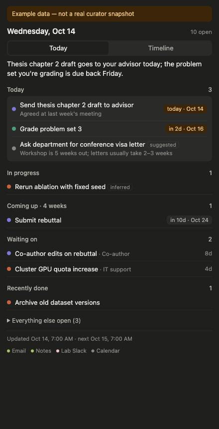
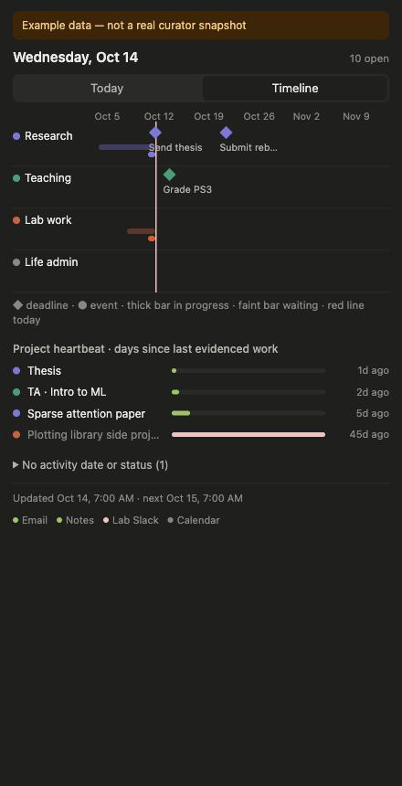

# BoardBar

A tiny macOS menu-bar app that shows your day: what to do today, what's coming up, what you're waiting on, and which projects you've gone quiet on.

BoardBar doesn't decide anything. An AI agent that already reads your email and notes (Codex, Claude, a cron job, anything) writes one JSON file each morning, and BoardBar draws it. The app only reads; it never writes to your notes.

<p>
  
  
</p>

*Screenshots use the made-up data in [`example/board.json`](example/board.json).*

## How it fits together

```
your sources (mail, notes, inbox…)
        │  read-only
        ▼
morning agent ──► board.tmp.json ──► validate_board.py ──► board.json (atomic rename)
                                                               │  read-only
                                                               ▼
                                                     BoardBar (menu bar)
```

- **The agent** is where the judgment happens: what's done, what matters, which three things come first.
- **The validator** rejects malformed snapshots, so a bad run never replaces a good one.
- **The app** draws two views:
  - **Today:** your top 3, in progress, coming up (4 weeks), waiting on, recently done.
  - **Timeline:** 6 weeks with one lane per area, and a heartbeat showing days since each project last saw real work.

It warns you when the snapshot is late (3h past `next_refresh_at`), missing, or invalid. If the new file is invalid, it keeps showing the last good snapshot.

## Install

Requires macOS 13+ and the Xcode command-line tools (`swiftc`).

```bash
git clone https://github.com/dmitry-guskov/boardbar.git
cd boardbar
./install.sh "/path/to/board.json"
```

`install.sh` builds the app, copies it to `~/Applications` and adds a LaunchAgent so it starts at login. Without an argument it reads `~/Documents/Obsidian Vault/07 Meta/board.json`. Remove everything with `./uninstall.sh`.

To try it without installing:

```bash
./build.sh
open BoardBar.app --args --board "$PWD/example/board.json"
```

You can also preview the view in a browser: run `python3 -m http.server` in this folder, then open `http://localhost:8000/board.html?board=example/board.json`.

## For the agent that writes `board.json`

The format is in [FORMAT.md](FORMAT.md). Give your agent that file plus these rules:

1. Read your sources; never edit them.
2. Write the **full** open inventory to `board.tmp.json`, not just what changed since yesterday.
3. Publish it with `python3 validate_board.py board.tmp.json --publish board.json`. On failure, report the error and leave the old board in place.
4. Mark uncertainty honestly: use `state: "unknown"` rather than guessing, and `basis: "recommendation"` for suggestions. An item missing from the file never means it's done.
5. Set `next_refresh_at` to the next scheduled run, so weekends don't show as "late".

Set `BOARD_PRIVATE_PREFIXES="Private/,Journal/"` to make the validator reject any `note_path` under those folders.

If `note_path` is relative to an Obsidian vault, clicking a task opens that note. The vault name is set by `vaultName` in `BoardBar.swift`.

## Files

| File | What it is |
|---|---|
| `BoardBar.swift` | Menu-bar shell: SwiftUI `MenuBarExtra` with a `WKWebView`. Watches the file every 30s and caches the last good snapshot. |
| `board.html` | Both views, plain HTML and JS, light and dark. Also works standalone in a browser. |
| `validate_board.py` | Format v1 validator and atomic publisher (standard library only). |
| `example/board.json` | Made-up sample data. |
| `build.sh`, `install.sh`, `uninstall.sh` | Build, install at login, remove. |

## License

MIT
