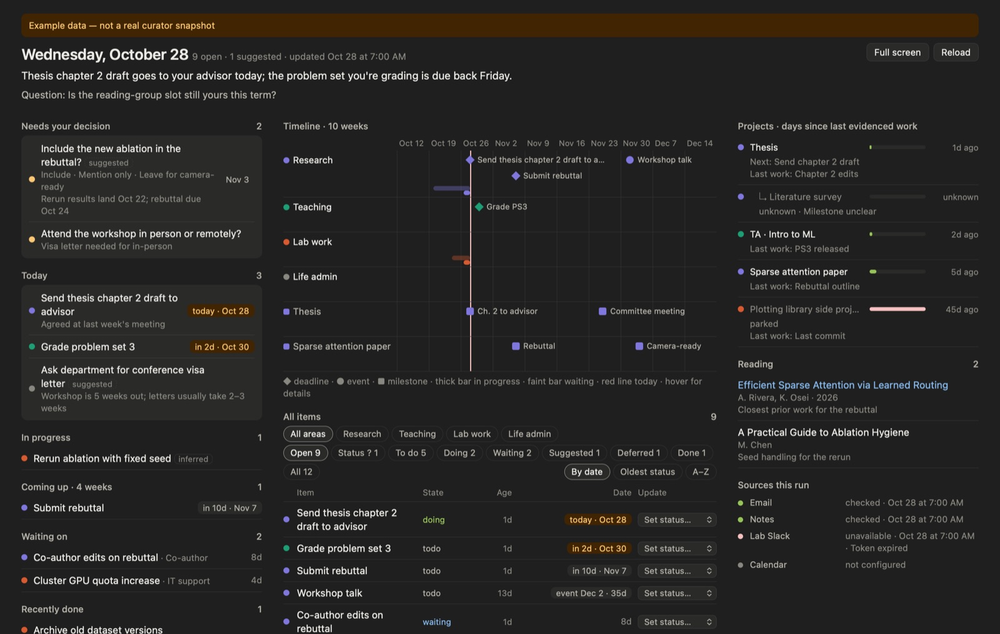
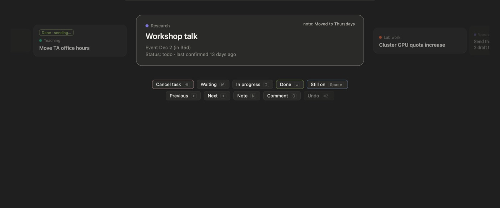

# BoardBar

A tiny macOS menu-bar app that shows your day: what to do today, what's coming up, what you're waiting on, and which projects you've gone quiet on.

BoardBar doesn't decide anything. An AI agent that already reads your email and notes (Codex, Claude, a cron job, anything) writes one JSON file each morning, and BoardBar draws it. The app only reads; it never writes to your notes.

<p>
  
  
</p>

**Double-click the popover (or click Expand ↗)** to open the full board in its own window, which can go full screen:



*Screenshots use the made-up data in [`example/board.json`](example/board.json). Example files (`"fixture": true`) are shifted to today's date so the demo always looks current.*

## How it fits together

```
your sources (mail, notes, inbox…)
        │  read-only
        ▼
morning agent ──► board.tmp.json ──► validate_board.py ──► board.json (atomic rename)
                                                               │  read-only
                                                               ▼
                                                     BoardBar (menu bar)
```

- **The agent** is where the judgment happens: what's done, what matters, which three things come first.
- **The validator** rejects malformed snapshots, so a bad run never replaces a good one.
- **The app** draws two views:
  - **Today:** your top 3, in progress, coming up (4 weeks), waiting on, recently done.
  - **Timeline:** 6 weeks with one lane per area, and a heartbeat showing days since each project last saw real work.

The **expanded view** adds:
- "Needs your decision"
- a list of what changed since the previous snapshot. The app works this out by comparing task IDs; a task that disappears is shown as "no longer listed", never as done.
- a 10-week timeline with a lane for each project that has milestones
- a table of every item, which you can filter by area or state and sort by date or by how old its status is
- project next steps (child projects nested under their parent), reading, and which sources were checked
- hover cards on the timeline with each item's full title, date, status and sources
- a **Set status…** menu on every item. It adds a line to `board-feedback.jsonl` for the curator to apply at its next run (see [FORMAT.md](FORMAT.md#feedback-log-and-receipts-11)). Each update shows as pending until the curator publishes a receipt.

**Comments:** hover any task (in the popover, the full board, or triage) and click **Comment** to leave a note for the curator. It's marked *for review* with the time of the next run until the curator acknowledges it, and its reply appears under your comment.

Suggestions (`basis: "recommendation"`) get their own group and aren't counted as open work.

**Triage** (press **T** in the full board, or click **Triage** in the popover) arranges items on a scrollable wheel, starting with unconfirmed items, oldest first. The current card shows full details, and its neighbours fade out to the left and right. Swipe sideways with two fingers, use `←` `→`, or click a neighbour. Each answer moves you to the next unanswered card, and answered cards keep a badge, so you can scroll back and change your mind.



| Key | Sends |
|---|---|
| `Space` | still on (`todo`) |
| `⌫` | cancel task (`cancelled`) |
| `↵` | `done` |
| `W` / `I` | `waiting` / `doing` |
| `N` | note to send with your next answer (`↵` keeps it, `Esc` discards it) |
| `C` | comment without changing the status (sends the typed note, if there is one) |
| `⌘Z` | undo |
| `O` / `Esc` | open the note / finish |

Each answer is held for 5 seconds before it's written to the feedback log, so `⌘Z` removes it cleanly. After that, a new answer for the same card wins. Queued answers are written when you finish or close the window.

It warns you when the snapshot is late (3h past `next_refresh_at`), missing, or invalid. If the new file is invalid, it keeps showing the last good snapshot.

## Install

Requires macOS 13+ and the Xcode command-line tools (`swiftc`).

```bash
git clone https://github.com/dmitry-guskov/boardbar.git
cd boardbar
./install.sh "/path/to/board.json"
```

`install.sh` builds the app, copies it to `~/Applications` and adds a LaunchAgent so it starts at login. Without an argument it reads `~/Documents/Obsidian Vault/07 Meta/board.json`. Remove everything with `./uninstall.sh`.

To try it without installing:

```bash
./build.sh
open BoardBar.app --args --board "$PWD/example/board.json"
```

Open the full board directly with `--expanded`. `--snapshot out.png` saves a PNG of the view, which is how the screenshots here were made:

```bash
./BoardBar.app/Contents/MacOS/BoardBar --board "$PWD/example/board.json" --expanded --snapshot docs/expanded.png
```

You can also preview the view in a browser: run `python3 -m http.server` in this folder, then open `http://localhost:8000/board.html?board=example/board.json&previous=example/previous.json`. A window 900px or wider shows the full board.

## For the agent that writes `board.json`

The format is in [FORMAT.md](FORMAT.md). Give your agent that file plus these rules:

1. Read your sources; never edit them.
2. Write the **full** open inventory to `board.tmp.json`, not just what changed since yesterday.
3. Publish it with `python3 validate_board.py board.tmp.json --publish board.json`. On failure, report the error and leave the old board in place.
4. Mark uncertainty honestly: use `state: "unknown"` rather than guessing, and `basis: "recommendation"` for suggestions. An item missing from the file never means it's done.
5. Set `next_refresh_at` to the next scheduled run, so weekends don't show as "late".

Set `BOARD_PRIVATE_PREFIXES="Private/,Journal/"` to make the validator reject any `note_path` under those folders.

If `note_path` is relative to an Obsidian vault, clicking a task opens that note. The vault name is set by `vaultName` in `BoardBar.swift`.

## Files

| File | What it is |
|---|---|
| `BoardBar.swift` | Menu-bar shell: SwiftUI `MenuBarExtra` with a `WKWebView`. Watches the file every 30s, caches the last good snapshot and the previous one (for the change list), and opens the expanded window. |
| `board.html` | Both views, plain HTML and JS, light and dark. Also works standalone in a browser. |
| `validate_board.py` | Format v1 / 1.1 validator and atomic publisher (standard library only). |
| `example/` | Made-up sample board, previous snapshot and feedback log. |
| `build.sh`, `install.sh`, `uninstall.sh` | Build, install at login, remove. |

## License

MIT
